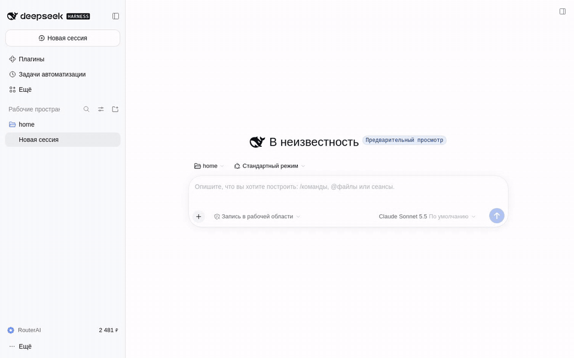
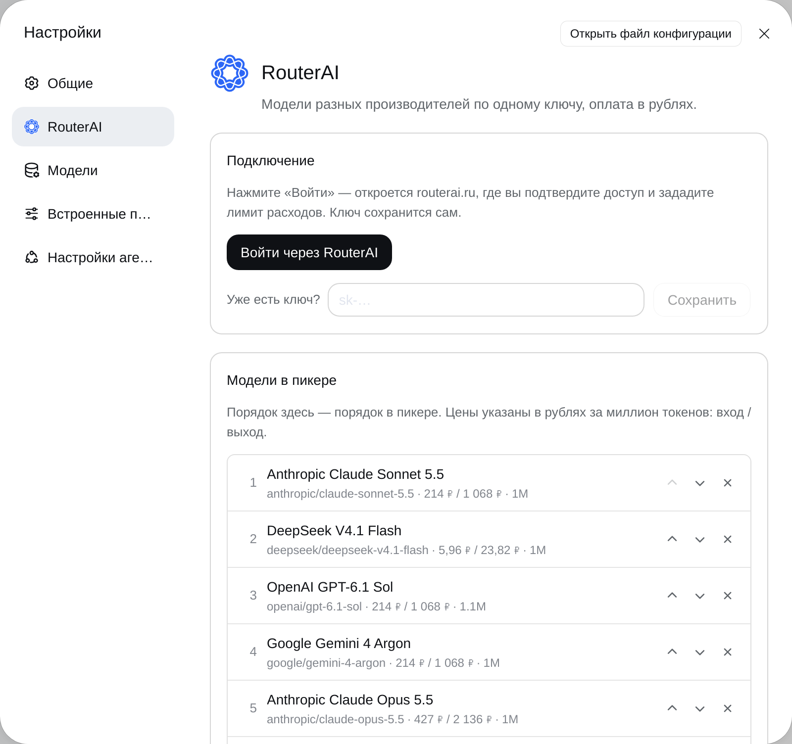
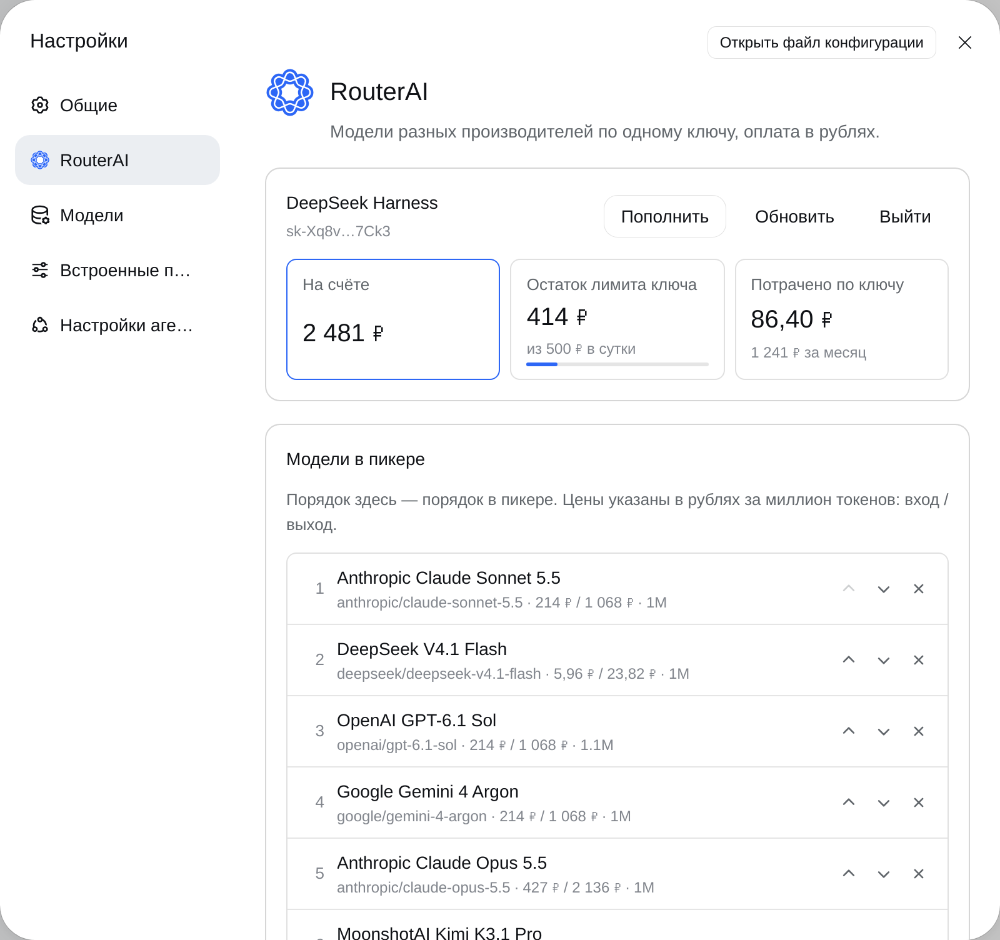
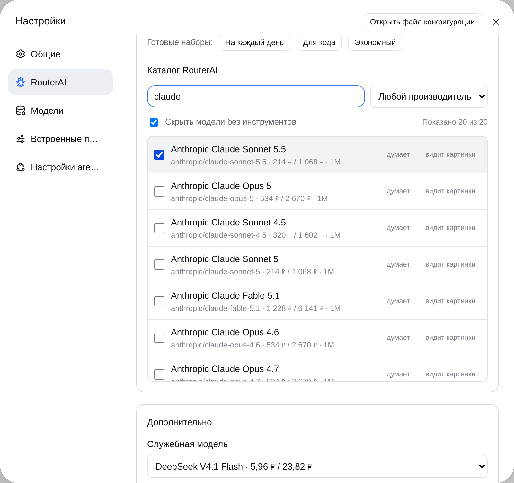
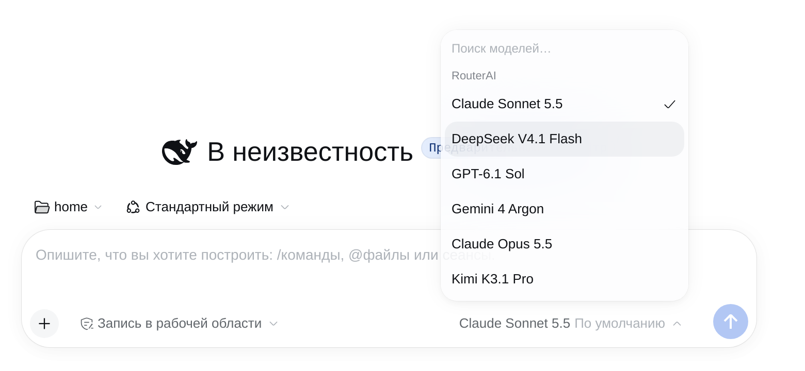
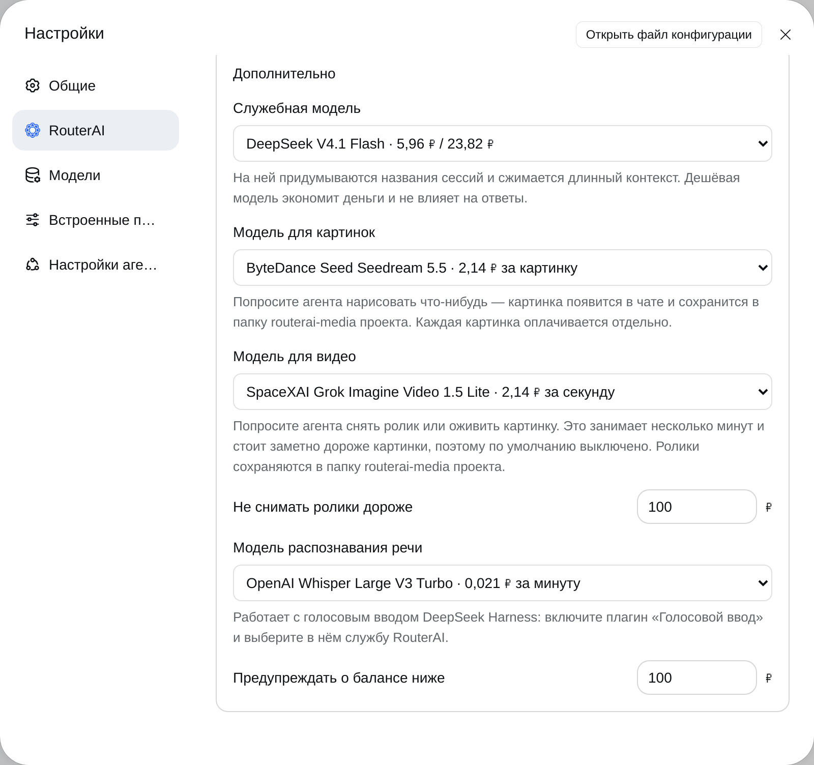
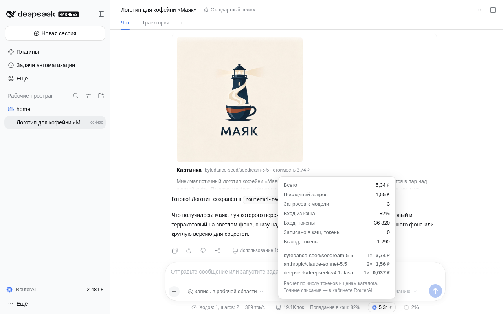
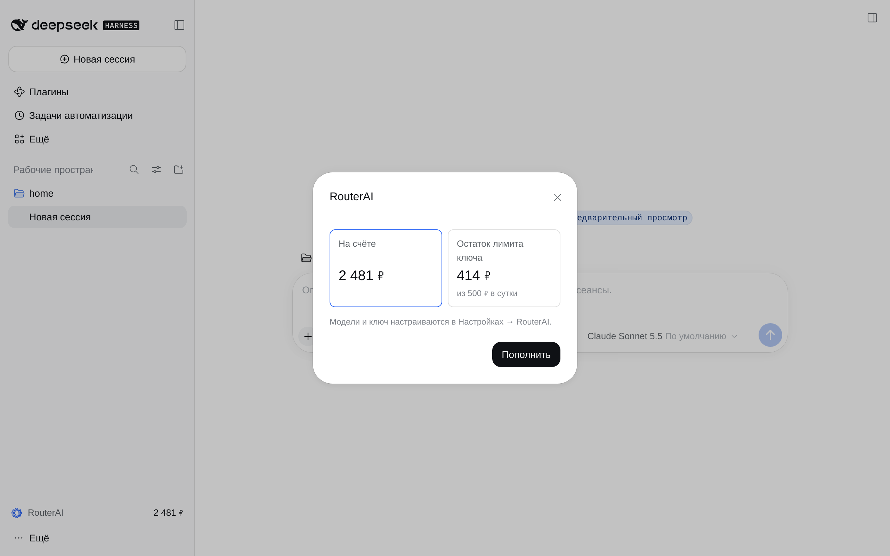
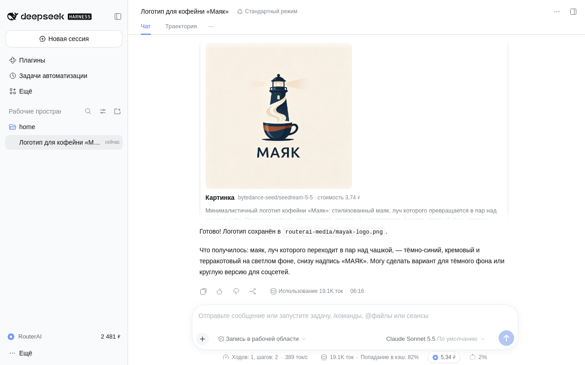
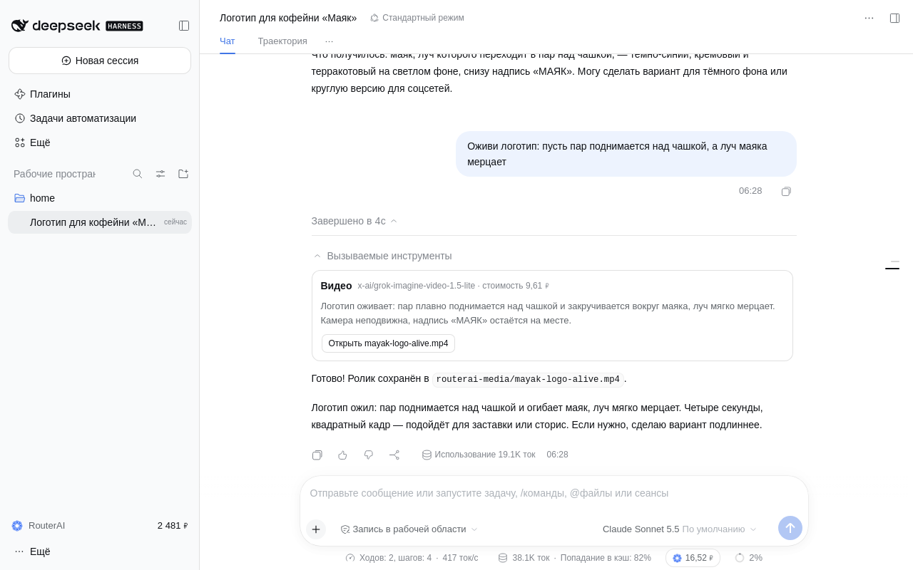

<h1 align="center">RouterAI для DeepSeek Harness</h1>

<p align="center">
  Claude, GPT, Gemini, DeepSeek, Qwen и сотни других моделей в DeepSeek Harness — по одному ключу, с оплатой в рублях.<br>
  Вход в один клик, баланс и стоимость каждой сессии перед глазами, картинки, видео и голосовой ввод.
</p>

<p align="center">
  <a href="https://www.npmjs.com/package/@router-ai/dsh-plugin-routerai"></a>
  
  
</p>

<p align="center">
  
</p>

[RouterAI](https://routerai.ru) — российский агрегатор языковых моделей: один аккаунт и один ключ вместо десятка
подписок, оплата в рублях. Этот плагин подключает его к [DeepSeek Harness](https://github.com/deepseek-ai/deepseek-harness)
как провайдера моделей и добавляет в приложение всё, что нужно для спокойной работы с платными моделями.

## Чем удобен

- **Не нужно копировать ключи.** Нажали «Войти» — подтвердили доступ на routerai.ru — ключ сохранился сам.
  Лимит расходов для него задаётся там же, на странице подтверждения.
- **Деньги на виду.** Остаток на счёте — в боковой панели, стоимость текущей сессии — под полем ввода,
  с разбивкой по моделям и долей входа из кэша.
- **Защита от неожиданных трат.** Лимит ключа, предупреждение о низком балансе, видео выключено по умолчанию,
  у ролика есть потолок стоимости. Если деньги закончились, вы увидите понятное сообщение и ссылку, а не код ошибки.
- **Весь каталог под рукой.** Более 350 чат-моделей с ценами в рублях: поиск, фильтр по производителю, готовые наборы.
- **Не только текст.** Агент рисует картинки и снимает видео, а голосовой ввод распознаёт речь через RouterAI.
- **Экономия на мелочах.** Названия сессий и сжатие контекста выполняет недорогая служебная модель, а не основная.

## Установка и настройка

### 1. Установите плагин

В приложении: **Плагины → Добавить плагин**, имя пакета `@router-ai/dsh-plugin-routerai`.

Или из терминала:

```sh
dsh plugin --profile desktop add @router-ai/dsh-plugin-routerai
```

Перезапустите приложение.

### 2. Войдите в RouterAI

Откройте **Настройки → RouterAI** и нажмите **Войти через RouterAI**.



В браузере откроется routerai.ru: выберите аккаунт, при желании задайте лимит расходов и подтвердите доступ.
Ключ сохранится в приложении автоматически. Аккаунта ещё нет — зарегистрируйтесь на [routerai.ru](https://routerai.ru).

Если ключ уже создан в [кабинете](https://routerai.ru/settings/keys), вставьте его в поле «Уже есть ключ?».

После входа в разделе появятся баланс, остаток лимита и расход ключа:



### 3. Выберите модели

Ниже — каталог RouterAI. Отметьте модели, которые хотите видеть в пикере, расставьте их по порядку стрелками
и нажмите **Применить**. Можно начать с готового набора: «На каждый день», «Для кода» или «Экономный».
Цены указаны в рублях за миллион токенов: вход / выход.



### 4. Работайте

Модели RouterAI появятся в пикере под полем ввода отдельной группой.



### 5. По желанию: картинки, видео, голос

В блоке **Дополнительно** выбираются модели для картинок, видео и распознавания речи, служебная модель
и порог предупреждения о балансе. У каждой модели указана цена.



## Возможности

### Стоимость сессии

Под полем ввода видно, сколько стоила текущая сессия. По нажатию — подробности: последний запрос, число
запросов, токены, доля входа из кэша и разбивка по моделям, включая служебную и модель для картинок.



Стоимость текста — расчёт по числу токенов и ценам каталога; стоимость картинок и видео RouterAI сообщает точно.
Итоговые списания всегда можно сверить в кабинете RouterAI.

### Баланс

Остаток на счёте всегда виден в боковой панели. Когда он опускается ниже заданного порога, строка
подсвечивается; по нажатию — сводка и кнопка пополнения.



### Картинки

Попросите агента: «нарисуй логотип для…», «сделай иллюстрацию к статье». Картинка появится в чате и сохранится
в папку `routerai-media` проекта — ею сразу можно пользоваться в работе.



Агент умеет и править картинки из проекта: «убери фон у логотипа», «нарисуй в том же стиле баннер»,
«сделай версию для тёмной темы». Можно задать размер, качество, формат и прозрачный фон — если выбранная
модель это поддерживает. По умолчанию рисуется размер 1K, за который указана цена в каталоге; крупнее стоит дороже.

Модель выбирается в настройках; там же рисование можно выключить, и агент перестанет тратить на него деньги.
У каждой модели свои возможности — число картинок за запрос, соотношения сторон, формат. Плагин берёт их
из каталога RouterAI и сообщает агенту; неподдерживаемое значение заменяется ближайшим допустимым, о чём сказано
в результате. Векторные модели сохраняют SVG в файл проекта.

### Видео

«Сними ролик, где…» или «оживи эту картинку» — агент создаст задачу, дождётся результата и сохранит mp4
в `routerai-media`. Картинка из проекта может стать первым кадром: так можно оживить логотип, который агент
только что нарисовал.



Вот что получилось — четыре секунды, 9,61 ₽:


Кроме первого кадра можно задать последний — получится плавный переход между двумя картинками, — передать
картинки-референсы персонажа или стиля и попросить звуковую дорожку. Что из этого доступно, зависит от модели.

Видео включается выбором модели в настройках: ролик делается несколько минут и стоит заметно дороже картинки.
Там же задаётся потолок стоимости одного ролика — дороже инструмент снимать не станет и объяснит почему.
Длительность, разрешение и соотношение сторон подгоняются под выбранную модель: если она не поддерживает
запрошенное значение, берётся ближайшее допустимое. Итоговая цена может быть выше оценки по каталогу:
первый кадр и высокое разрешение оплачиваются дополнительно.

### Голосовой ввод

RouterAI работает как служба распознавания речи для голосового ввода DeepSeek Harness. Голосовой ввод —
отдельный экспериментальный пакет harness: установите `@deepseek-ai/dsh-experimental-voice-input-bundle`
и выберите службу **RouterAI**. Модель распознавания задаётся в настройках плагина.

### Понятные отказы

Закончились деньги, ключ упёрся в лимит или был отключён — вместо технической ошибки вы увидите, что именно
произошло и что с этим делать, со ссылкой на пополнение или на страницу ключей.

### Служебная модель

Названия сессий и сжатие длинного контекста harness по умолчанию поручает той же модели, что ведёт разговор.
Плагин переводит эти запросы на недорогую модель — на качество ответов это не влияет. Модель можно сменить
или отключить подмену.

## Команда `/routerai`

Те же действия доступны из чата:

| Команда | Что делает |
|---|---|
| `/routerai login` | вход через routerai.ru |
| `/routerai key sk-…` | сохранить готовый ключ |
| `/routerai logout` | удалить сохранённый ключ |
| `/routerai status` | баланс аккаунта и состояние ключа |
| `/routerai models` | модели пикера с ценами |
| `/routerai find <текст>` | поиск по каталогу RouterAI |

## Настройка без интерфейса

Ключ можно передать переменной окружения `ROUTERAI_API_KEY` или записать в `.env`.
Параметры плагина задаются в `~/.dsh/profiles/<профиль>/cordis.patch.yml`:

```yaml
- id: llm-routerai
  config:
    models:
      - anthropic/claude-sonnet-5.5
      - deepseek/deepseek-v4.1-flash
```

| Параметр | По умолчанию | Назначение |
|---|---|---|
| `models` | набор «На каждый день» | модели пикера по порядку; выбор в настройках приложения важнее |
| `apiKeyEnv` | `ROUTERAI_API_KEY` | имя, под которым хранится ключ |
| `baseURL` | `https://routerai.ru/api/v1` | адрес API |
| `catalogRefreshHours` | `4` | как часто обновлять каталог и цены |

Идентификаторы моделей — как в [каталоге RouterAI](https://routerai.ru/models): `производитель/модель`.

## Совместимость

DeepSeek Harness 0.2.x. Harness пока выходит в предварительных версиях, поэтому совместимость с каждой
новой сборкой проверяется автоматически раз в сутки.

## Разработка

Нужен Node.js 24.

```sh
npm ci
npm run typecheck
npm test
npm run build
```

Выпуск версии: обновить `version` в `package.json`, добавить раздел в `CHANGELOG.md`, поставить тег
`vX.Y.Z`. Публикацию в npm и релиз на GitHub выполняет `.github/workflows/release.yml`.

## Поддержка и лицензия

Вопросы и ошибки — в [задачах репозитория](https://github.com/router-ai/dsh-plugin-routerai/issues)
или на почту [support@routerai.ru](mailto:support@routerai.ru).

Лицензия MIT.
