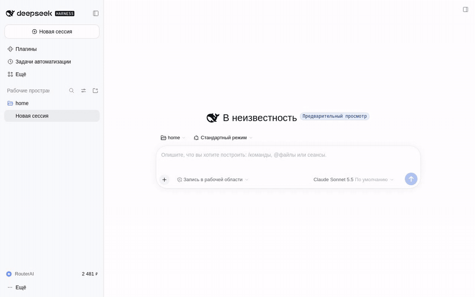

# RouterAI

[RouterAI](https://routerai.ru) puts models from many vendors — Anthropic, OpenAI, Google, DeepSeek, Qwen and
others — behind a single key and bills in rubles. This plugin adds those models to DeepSeek Harness.

## Getting started

1. Open **Settings → RouterAI** and press **Sign in with RouterAI**. Approve access on routerai.ru and the key
   is saved for you. You can also paste an existing key there.
2. Tick the models you want in the catalog and press **Apply**.
3. Pick a RouterAI model in the model picker.

## What you get

- A model catalog with prices in rubles per million tokens, search and ready-made sets.
- Balance in the sidebar and the session cost under the composer.
- Clear messages when the balance runs out or the key hits its spending limit.
- Savings: session titles and context compaction run on an inexpensive utility model.
- Images: ask the agent to draw — the result appears in the chat and in the project's `routerai-media` folder.
- Video: the agent makes short clips and animates images; enabled by choosing a model in the settings.
- Voice input: RouterAI recognizes speech for the Voice input plugin.
- The `/routerai` command for the same actions from the chat: `login`, `key`, `logout`, `status`, `models`, `find`.
