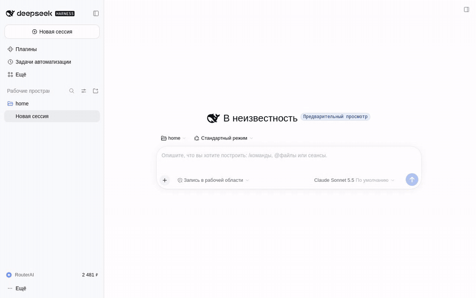

# RouterAI

[RouterAI](https://routerai.ru) собирает модели разных производителей — Anthropic, OpenAI, Google, DeepSeek,
Qwen и многих других — за одним ключом и принимает оплату в рублях. Плагин добавляет эти модели в DeepSeek Harness.

## Как начать

1. Откройте **Настройки → RouterAI** и нажмите **Войти через RouterAI**. Подтвердите доступ на routerai.ru —
   ключ сохранится сам. Готовый ключ можно вставить там же.
2. Отметьте нужные модели в каталоге и нажмите **Применить**.
3. Выберите модель RouterAI в пикере.

## Что вы получаете

- Каталог моделей с ценами в рублях за миллион токенов, поиском и готовыми наборами.
- Баланс в боковой панели и стоимость сессии под полем ввода.
- Понятные сообщения, если закончились деньги или ключ упёрся в лимит.
- Экономия: названия сессий и сжатие контекста делает недорогая служебная модель.
- Картинки: попросите агента нарисовать или изменить картинку из проекта — результат появится в чате и в папке `routerai-media`.
- Видео: агент снимает короткие ролики и оживляет картинки; включается выбором модели в настройках.
- Голосовой ввод: RouterAI распознаёт речь для плагина «Голосовой ввод».
- Команда `/routerai` для тех же действий из чата: `login`, `key`, `logout`, `status`, `models`, `find`.
